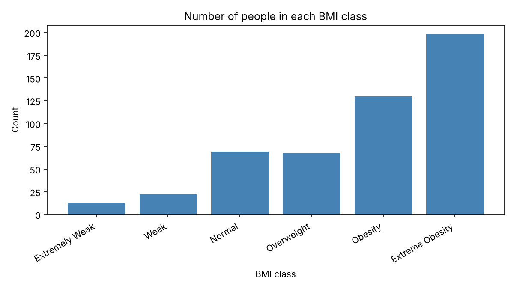
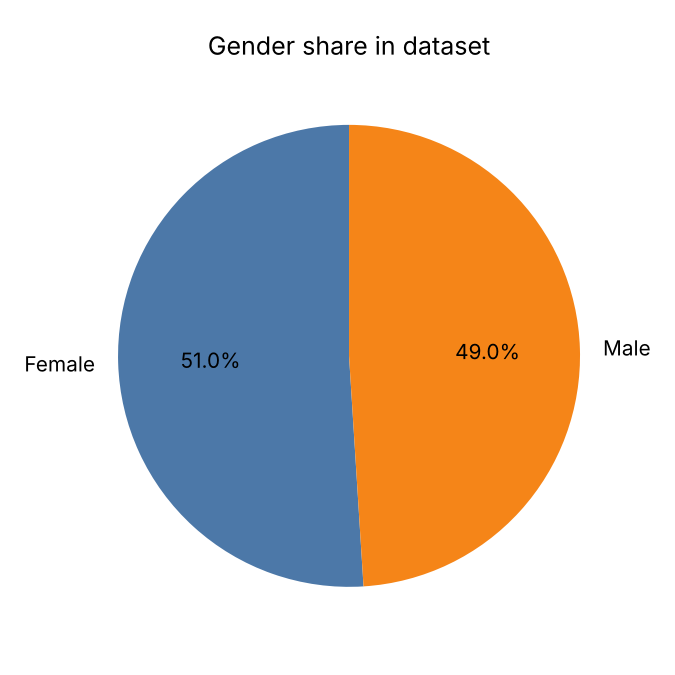
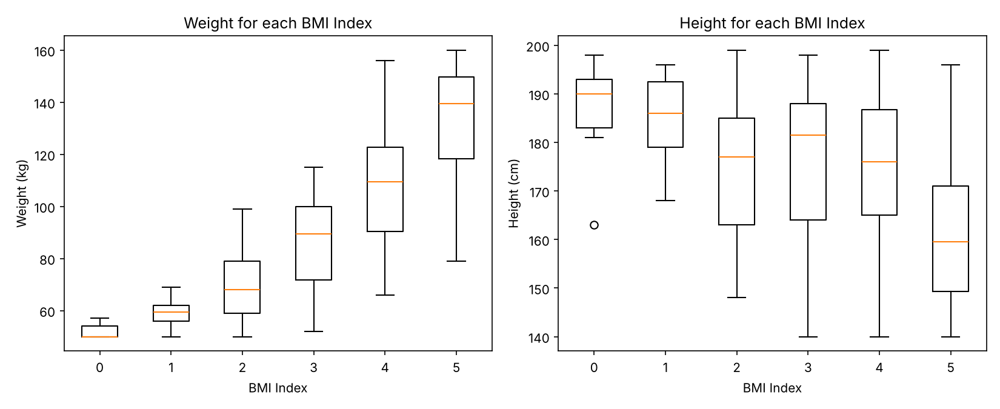
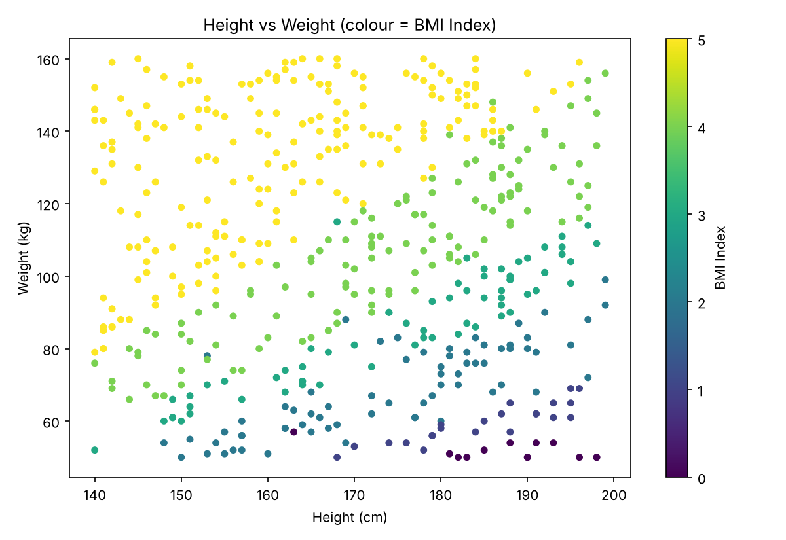
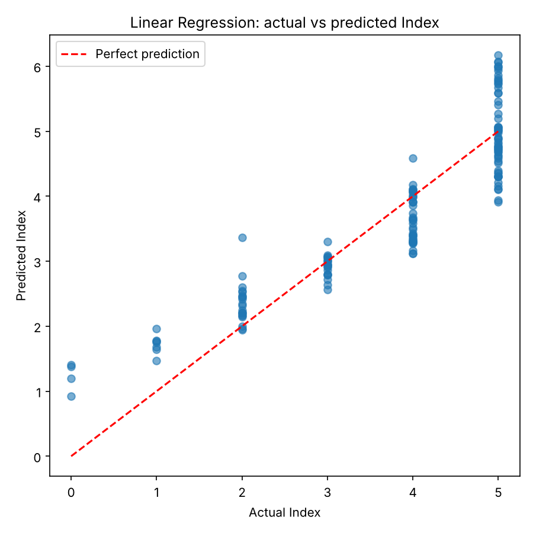
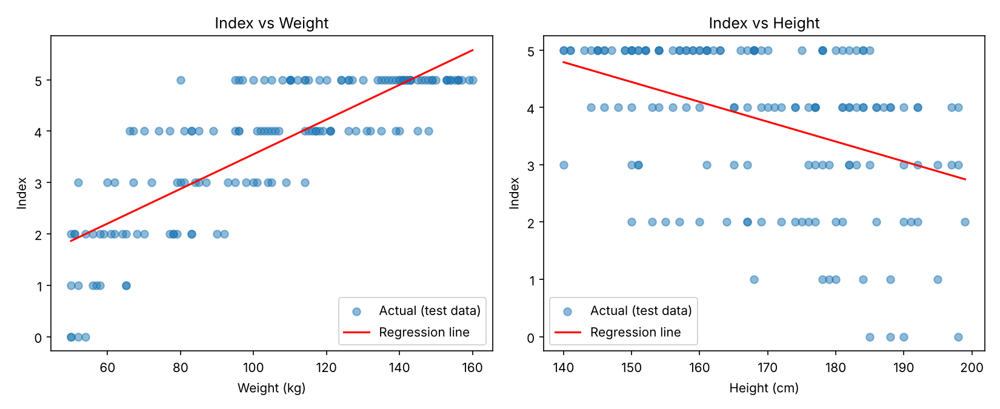
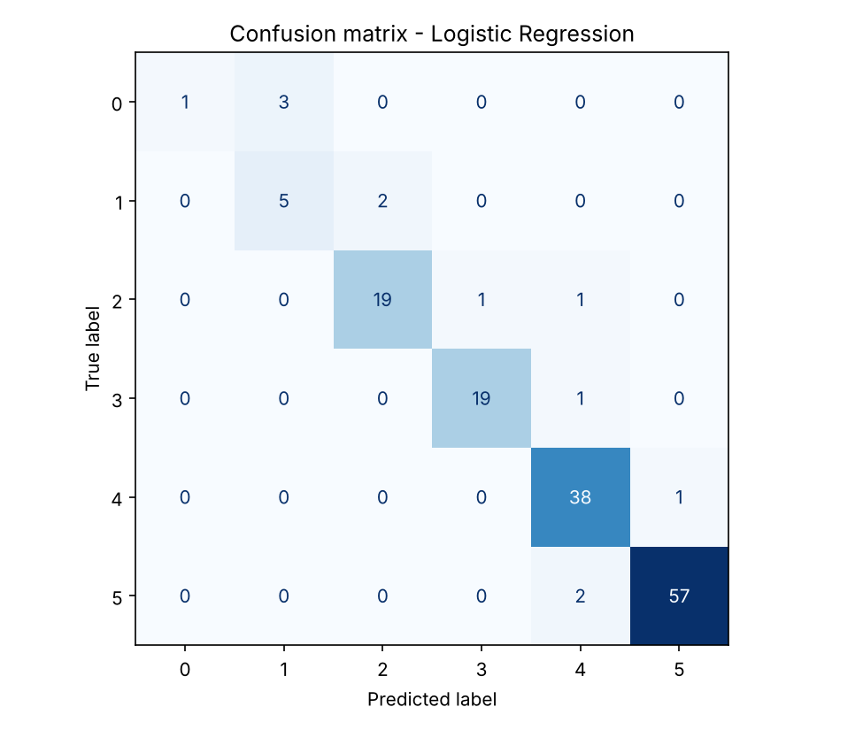
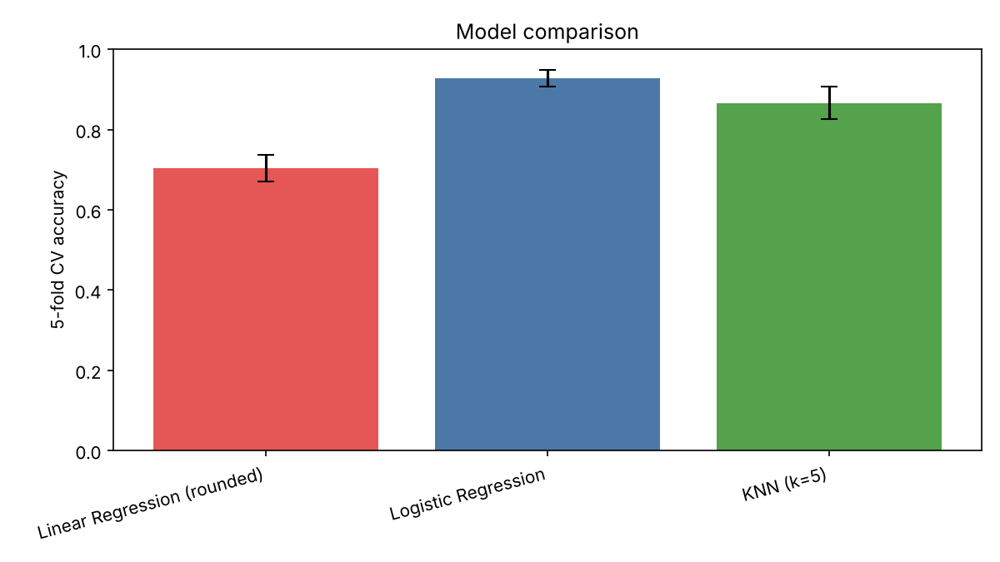

# BMI Estimation using Machine Learning

Minor project for the **Machine Learning using Python** course by Naviotech Solutions Pvt. Ltd., Indore.

**Author:** Rahul Bhardwaj, B.Sc. Industrial Chemistry, Deshbandhu College, University of Delhi

## Problem statement

Estimate a person's **BMI Index** from three inputs: **Gender**, **Height (cm)** and **Weight (kg)**.

The `Index` column in the dataset is a BMI category from 0 to 5:

| Index | Class |
|------:|-------|
| 0 | Extremely Weak |
| 1 | Weak |
| 2 | Normal |
| 3 | Overweight |
| 4 | Obesity |
| 5 | Extreme Obesity |

## Dataset

`data/bmi.xlsx` has 500 rows and 4 columns (`Gender`, `Height`, `Weight`, `Index`). There are no missing values, and 255 rows are Female and 245 are Male. The classes are imbalanced: 198 people are in class 5 but only 13 are in class 0.

## Course topics used

| Course topic | Where it is used |
|---|---|
| Pandas and Excel reading | `pd.read_excel` loads the data |
| Bar, pie, box and scatter plots | Data exploration graphs |
| Train/test split | 70% train, 30% test, stratified |
| k-fold cross validation | 5-fold CV to compare models |
| Accuracy, precision, recall, confusion matrix | Evaluating the classifiers |
| Linear regression | Model 1 |
| Logistic regression | Model 2 |
| K-Nearest Neighbour | Model 3 |

## Approach

1. Read the Excel file and explore it with plots.
2. Encode Gender (Female = 0, Male = 1) using `LabelEncoder`.
3. Split the data into 70% training and 30% testing data.
4. Train three models:
   - **Linear Regression** predicts the Index as a decimal, which is then rounded to the nearest class.
   - **Logistic Regression** predicts the class directly. Inputs are standardised first.
   - **KNN (k = 5)** predicts the class from the 5 nearest people. Inputs are standardised first.
5. Compare the models using test accuracy and 5-fold cross validation.
6. Use the best model to predict the Index for new people.

## Results

| Model | Test accuracy | 5-fold CV accuracy |
|---|---:|---:|
| Linear Regression (rounded) | 69.3% | 70.4% |
| KNN (k = 5) | 85.3% | 86.6% |
| **Logistic Regression** | **92.7%** | **92.8%** |

Linear regression on its own scored RMSE = 0.564 and R² = 0.829 on the test data.

The notebook shows precision and recall for every class, and all outputs are saved inside it.

### Graphs

| | |
|---|---|
|  |  |
|  |  |
|  |  |
|  |  |

## Observations

- **Weight matters most.** Heavier people have a higher Index. Height has a negative coefficient: for the same weight, a taller person gets a lower Index. This matches the BMI idea (weight divided by height squared).
- **Gender has a very small effect.** Its coefficient in the linear model is only 0.06.
- **Linear regression is the weakest model.** The Index is a category, not a smooth number, and the relationship with weight and height is not a straight line. Rounding a decimal to the nearest class loses accuracy.
- **Logistic regression is the best.** It treats the Index as a class and does best on both the test set and cross validation.
- **The small classes are harder.** Classes 0 and 1 have only 13 and 22 people in total, so the models make more mistakes there. The confusion matrix shows this.

## Limitations and future work

- The dataset is small (500 rows) and imbalanced.
- Class 2 (Normal) and class 3 (Overweight) overlap in BMI, so the labels are not a clean BMI cut-off.
- Possible improvements: add BMI (`weight / (height/100)²`) as a new feature, tune `k` for KNN, and try Decision Trees or Random Forest.

## Project structure

```
bmi-estimation/
├── data/
│   └── bmi.xlsx              # dataset
├── bmi_estimation.ipynb      # complete project (code, explanations, outputs)
├── outputs/                  # graphs saved by the notebook
├── requirements.txt
├── .gitignore
└── README.md
```

## How to run

```bash
# 1. Clone the repository
git clone https://github.com/<your-username>/bmi-estimation.git
cd bmi-estimation

# 2. (Optional) create a virtual environment
python -m venv venv
venv\Scripts\activate          # Windows
# source venv/bin/activate     # Linux / Mac

# 3. Install the libraries
pip install -r requirements.txt

# 4. Open the notebook
jupyter notebook bmi_estimation.ipynb
```

Run the notebook from the project folder (the one that contains `data/`), then choose **Kernel -> Restart & Run All**. The graphs are saved in the `outputs/` folder.

## Tools

Python, Jupyter Notebook, pandas, NumPy, scikit-learn, Matplotlib, openpyxl
